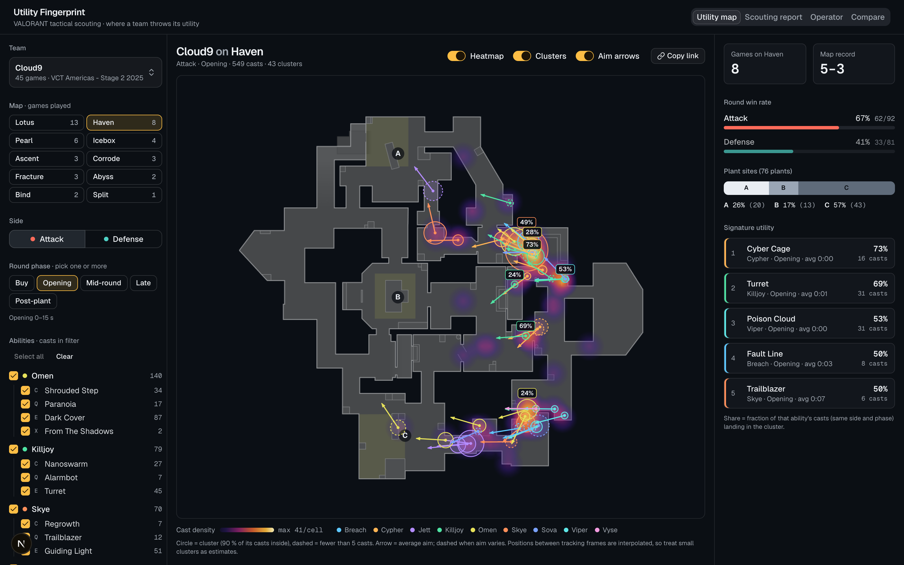
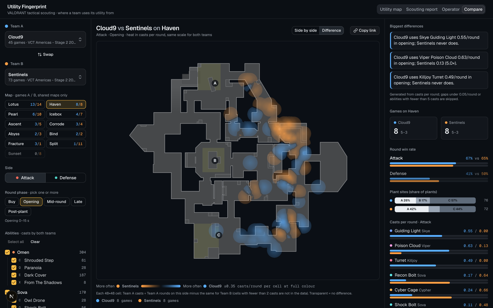
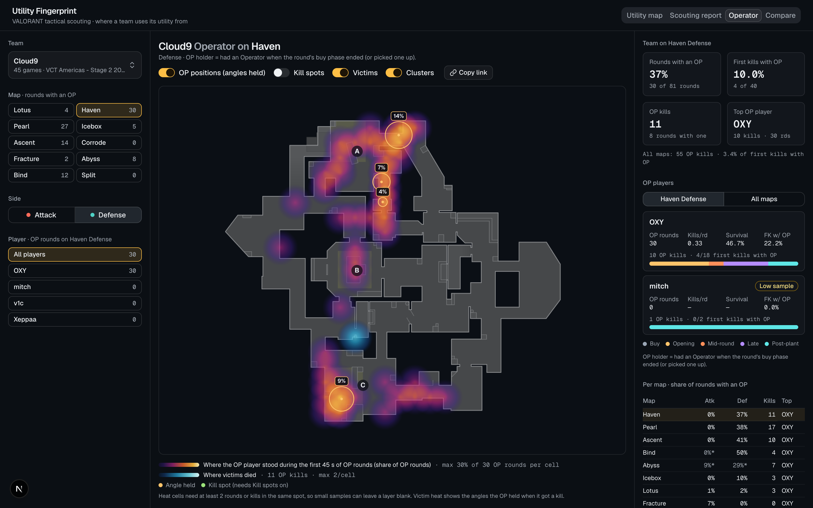
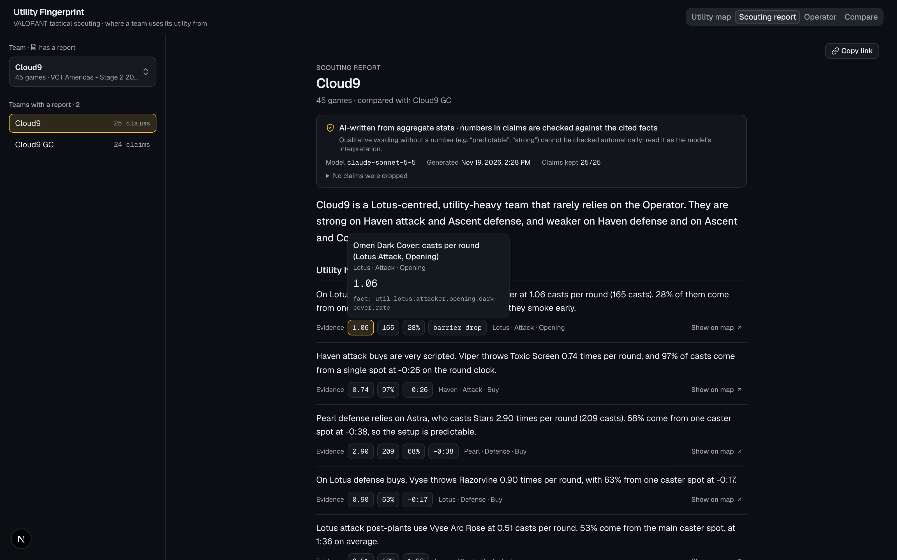
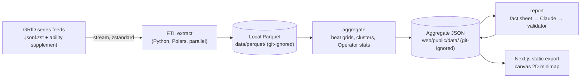

# Utility Fingerprint

VALORANT tactical scouting for **Sky's The Limit 2026 — Cloud9 x JetBrains Hackathon** (category: VALORANT
Tactical Scouting). Utility Fingerprint turns GRID match feeds and the ability-cast supplement into a per-team
"fingerprint": where and when a team uses its utility and holds the Operator, drawn on the minimap per side and
round phase. A Claude-written scouting report, whose numbers in claims are validated against the cited facts,
sums it up for the coaching staff.

<!-- TODO: enable after organizer answer (docs/screenshots/ is not committed yet, links would break)




-->

## Features

All filters live in the URL, so every view is a shareable link (`Copy link` button).

- **Utility map** — heatmap, clusters and aim arrows of where a team's players stood when they used each ability,
  filtered by map, side (attack/defense), round phase (buy, opening 0–15 s, mid 15–45 s, late, post-plant) and
  ability. A summary panel lists the signature setups; clicking a cluster shows its agent, share of casts and timing.
- **Compare** — two teams on the same map/side/phase, side by side or as a diff heatmap. Heat is normalised per
  round played, so teams with different sample sizes compare fairly. Default opponent: Cloud9.
- **Operator** — who holds the Operator, how often per map/side, kills, survival and share of first kills, plus
  layers for holder positions in the first 45 s ("angles held"), kill positions, victim positions and clusters.
- **Report** — a pre-generated scouting report per team (Claude): headline, sections (utility, Operator, map pool,
  versus reference) and counter-strategy suggestions. Every claim cites its facts; clicking a fact shows the
  underlying value, and each claim links to the matching dashboard view.

## Quick start

### Prerequisites

| Tool | Version | Used for |
|---|---|---|
| Python | 3.12+ (`etl/.python-version`: 3.12) | ETL |
| [uv](https://docs.astral.sh/uv/) | 0.12+ | Python env and runs |
| Node.js | 20.9+ (Next.js 16 requirement) | web |
| pnpm | 11.7 (`packageManager` in `web/package.json`) | web |
| GRID starter data | hackathon data repo | input, never committed |
| Claude API key or Claude Code CLI | optional | `report` only |

### (a) From the GRID data (full pipeline)

Clone the official hackathon data repo **outside** this repo and point `STL_DATA_DIR` at it (default:
`../stl-hackathon-2026-grid-starter`). Nothing loads a `.env` file: export the variable in your shell or pass it
inline per command (`.env.example` only lists the variables).

```bash
git config core.hooksPath .githooks          # once per clone: blocks committing data
export STL_DATA_DIR=/path/to/stl-hackathon-2026-grid-starter

cd etl
uv sync
uv run python -m utility_fingerprint_etl build
# ~6 min on a laptop; resumable. --force re-extracts, --limit N for a quick dev run, --aggregate-only re-aggregates

# optional: scouting reports (see "Scouting reports" below)
uv run python -m utility_fingerprint_etl report --teams 79,3429 --dry-run   # fact sheets + prompts, no LLM call

cd ../web
pnpm install
pnpm dev                                     # http://localhost:3000
```

Network: the first `build` downloads map coefficients from `https://valorant-api.com/v1/maps` once and caches them
in `etl/.cache/valorant-api-maps.json` (git-ignored; later builds run offline; delete the file to refresh). The
browser loads the minimap images from valorant-api.com as well, so the dashboard needs internet access for the
map backgrounds (overlays still draw without them).

### (b) Local static demo (data already built)

With `web/public/data/` in place (from step a):

```bash
cd web
pnpm install
pnpm export          # static site in web/out/ (includes the data), checks index.html + data/index.json
pnpm serve:static    # needs python3; http://127.0.0.1:4173 — try /?tab=report&team=79
```

The export holds ~31 MB of team JSON (~32 MB including reports, ~33 MB with the app). Any static server works instead of
`serve:static`, e.g. `npx serve out`.

### (c) Deploy

The aggregate JSON is git-ignored, so a git-connected build would have no data. `scripts/deploy-vercel.sh`
builds the static export locally and uploads `web/out/` to Vercel as a static site. It refuses to deploy until
the organizers allow hosting (set `UF_ORGANIZER_APPROVED=yes`); `scripts/deploy-vercel.sh --check` only builds
and verifies. Details, the three organizer-answer scenarios and optional separate data hosting
(`NEXT_PUBLIC_DATA_BASE_URL`): [`docs/deploy.md`](docs/deploy.md).

## Architecture



1. **Extract** (`etl/.../extract.py`): streams each series' events line by line, keeps only the needed event types,
   applies GRID reversals (`!killed`, `team-!won-round`, …), drops games not in `meta/games.csv`, and writes rounds,
   kills, casts, Operator stints and holder positions per series to Parquet (resumable).
2. **Aggregate** (`aggregate.py`): per team, map, side, phase and ability → heat grids (only cells with ≥ 2 events),
   DBSCAN clusters, timings and Operator profiles; ~31 MB of team JSON for 143 teams, ~32 MB including reports (teams with < 5 games skipped).
3. **Report** (`report.py`, optional): see below.
4. **Web** (`web/`): Next.js App Router, TypeScript, Tailwind, shadcn/ui; one client-rendered page that fetches team
   JSON on demand and draws on a `<canvas>` over the valorant-api.com minimap.

Key definitions (full list in [`docs/data-pipeline.md`](docs/data-pipeline.md)):

- **Round clock / phase:** time since the round's freezetime end. `buy` < 0, `opening` 0–15 s, `mid` 15–45 s,
  `late` > 45 s before the plant, `post_plant` after it. The first second is shown as "barrier drop".
- **Side:** per round from the `team-won-round` winner's side, with the round-start snapshot as fallback.
- **Operator holder:** an Operator in the player's inventory at freezetime end, an Operator pickup, or an Operator
  kill by a player not yet known to hold one (`kill_inferred`); a stint ends when the holder dies.
- **Calibration:** GRID x/y → minimap with valorant-api coefficients, axes swapped
  (`u = y·xMultiplier + xScalarToAdd`, `v = x·yMultiplier + yScalarToAdd`); see
  [`docs/calibration.md`](docs/calibration.md).

## Scouting reports

`report` builds a deterministic fact sheet (≤ 150 facts: map pool, utility signatures, Operator profile, largest
gaps versus Cloud9, or versus Cloud9 GC for Cloud9 itself) from the published aggregates only. It asks Claude
(`claude-sonnet-5-5`, override with `UF_REPORT_MODEL`) for a structured JSON report whose claims cite fact ids.
A validator extracts every number in each claim and requires it to match a cited fact (percent ±0.5 points,
rates ±0.01, counts exact). It rejects number words and multipliers and requires a number-free headline. Failing
claims get one retry; claims that still fail are dropped and listed under `validation`. Results are cached by
fact sheet, prompt, schema, validator version and model.

```bash
cd etl
ANTHROPIC_API_KEY=... uv run python -m utility_fingerprint_etl report --teams 79,3429  # key for this command only
uv run python -m utility_fingerprint_etl report --top 20          # Cloud9, Cloud9 GC, then teams with most games
uv run python -m utility_fingerprint_etl report --top 20 --check  # re-validate written reports, detect stale facts
```

Without `ANTHROPIC_API_KEY` the command uses the Claude Code CLI (`claude -p`, isolated: no tools, no MCP, no
saved session). **Do not `export ANTHROPIC_API_KEY` in the shell where Claude Code runs**: Claude Code would then
bill that key instead of your subscription. Pass it inline for the single command as shown.

**Limits:** the validator checks numbers, not meaning. Qualitative or directional wording ("more aggressive",
"prefers B") and whether a number is attached to the right side/map are only constrained by the cited facts,
which are embedded in each report for review.

## Data license

The GRID data is licensed **for the hackathon only**. In short: no redistribution: the data or "any part or
derivative of it" may not be published, uploaded or committed to any public or shared repository. No commercial
use, and no use after the hackathon. Results, statistics and charts may be shown to judges and organizers.

What this repo does about it:

- Nothing from the data is committed. `.gitignore` covers `*.zst`, `*.jsonl`, `*.parquet`, `/data/`,
  `/web/public/data/`, `/web/out/`, `docs/poc/` and, until the organizers answer, `docs/screenshots/`.
- `.githooks/pre-commit` refuses staged data files and those folders (`git config core.hooksPath .githooks`).
- The ETL reads the data from `STL_DATA_DIR` outside the repo and never copies raw rows into the output.
  Published JSON holds aggregates only (heat cells with ≥ 2 events, clusters, rates).
- A public hosted demo waits for the organizers' answer (`docs/organizer-question.md`, `docs/deploy.md`).

## Known limitations

- **Caster position, not landing spot.** The ability supplement gives where the player stood when casting, not
  where the smoke/flash landed; heatmaps and clusters show caster positions.
- **Operator pickups are not in the feed.** There are no buy events and no Operator `pickedUp` events in the
  data, so holders come from the freezetime-end inventory plus `kill_inferred`. Drops picked up by the enemy are
  invisible (`op_lost_to_enemy` is always 0).
- **Qualitative report wording is not validated** (see Scouting reports).
- **Small samples.** Low-sample clusters, Compare maps and Operator splits are marked in the dashboard and left
  out of the report fact sheet. Several
  teams have few games per map, so read rates with their sample size.
- Some rounds lack a freezetime-end event; their round clock and phase stay null instead of being guessed.

## Project structure

| Path | What |
|---|---|
| `etl/src/utility_fingerprint_etl/` | `__main__.py` (CLI: `inspect`, `poc`, `build`, `report`), `extract.py`, `build.py`, `aggregate.py`, `report.py`, `geometry.py`, `rules.py` |
| `etl/tests/` | pytest suite (extract/aggregate, Operator, report validator with a fake LLM provider) |
| `web/src/` | Next.js app: `app/`, `components/` (map, compare, operator, report, filters), `lib/` (data loading, URL state) |
| `web/vercel.json` | headers for the static deployment |
| `scripts/deploy-vercel.sh` | guarded static deploy |
| `docs/` | `data-pipeline.md`, `calibration.md`, `data-schema.md`, `deploy.md`, `organizer-question.md`, `ai-workflow-log.md` |
| `.githooks/pre-commit` | blocks committing data |

Submission drafts: [`docs/methodology.md`](docs/methodology.md) (methodology writeup),
[`docs/devpost-submission.md`](docs/devpost-submission.md) (Devpost form text) and
[`docs/video-script.md`](docs/video-script.md) (≤ 3 min demo video script).

## Testing

```bash
cd etl && uv run pytest                 # no network, no GRID data needed
cd web && pnpm lint && pnpm build       # build = static export to web/out/
```

## How it was built

- **JetBrains:** TODO(user): confirm JetBrains tools (assumed WebStorm / PyCharm + Junie).
- **Claude Code** (Anthropic) assisted with most of the code, tests and docs. Its steps and decisions are logged in
  [`docs/ai-workflow-log.md`](docs/ai-workflow-log.md).
- **Claude** (`claude-sonnet-5-5`) writes the scouting reports at build time, from aggregates only, behind the number
  validator.
- Map images and calibration coefficients come from the community [valorant-api.com](https://valorant-api.com)
  (cached in `etl/.cache/`, git-ignored).

## License

Code: MIT (see [`LICENSE`](LICENSE)). Match data: © GRID eSports GmbH / Riot Games / Cloud9, not included and not
redistributed. This project is not endorsed by Riot Games.
